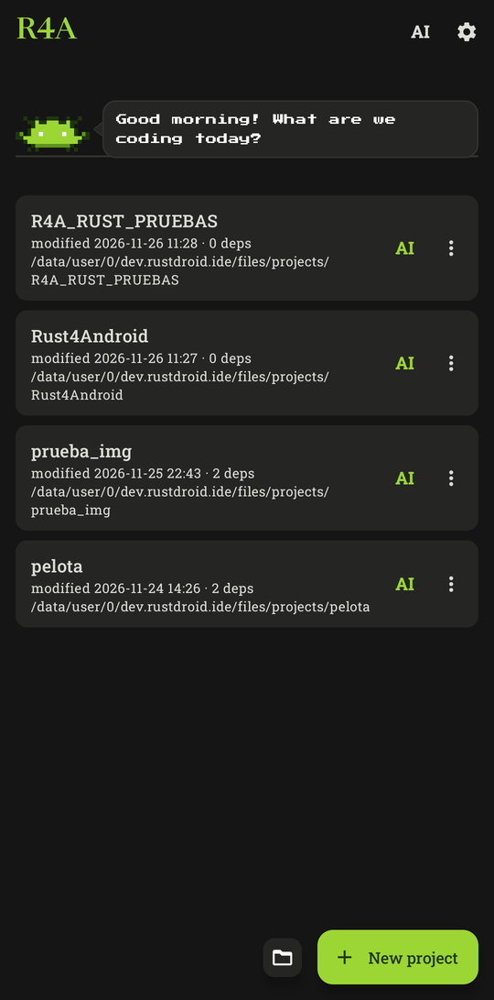
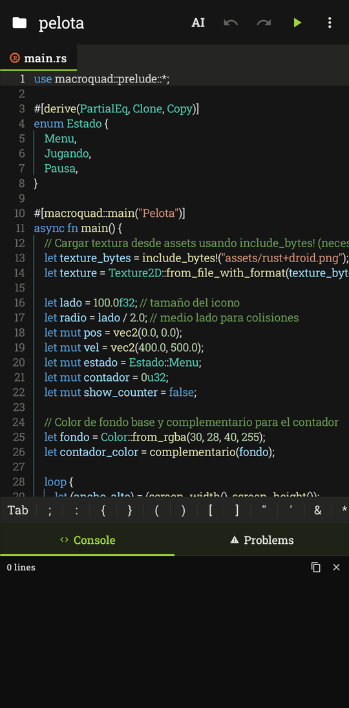
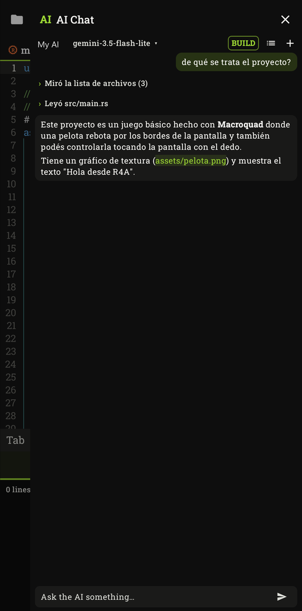
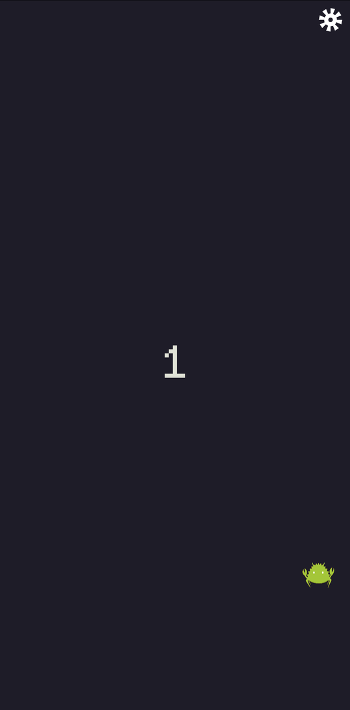
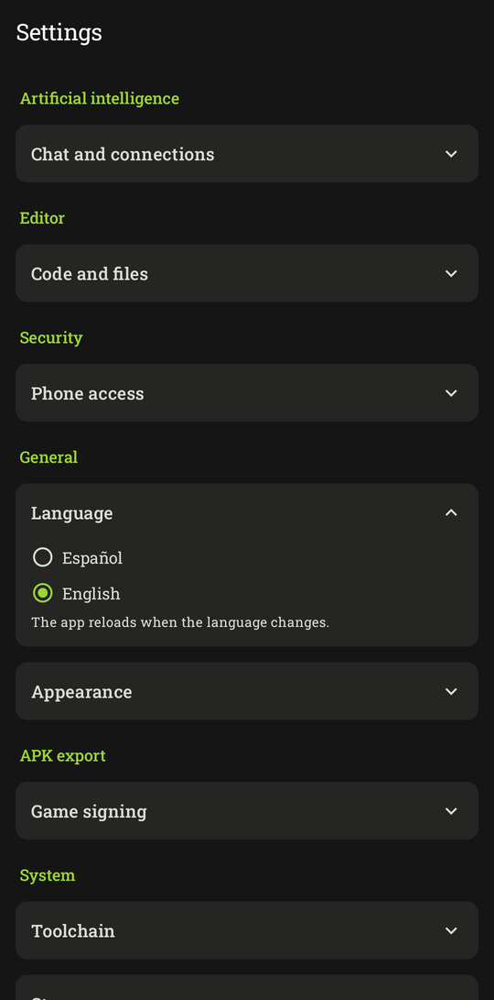

<p align="center">
  
</p>

<h1 align="center">R4A — Rust for Android</h1>

<p align="center">
  <a href="https://github.com/4404c/Rust4Android/releases/latest"></a>
  <a href="https://github.com/4404c/Rust4Android/releases"></a>
  <a href="LICENSE"></a>
  
</p>

<p align="center">
  Write, build and run Rust on your phone.<br>
  No PC, no root, no Termux.
</p>

<p align="center">
  
  
  
  
  
</p>

R4A is a Rust IDE for Android. It installs a real Rust toolchain (`rustc` + `cargo`) inside the app, so you can code, compile and run Rust programs and games right on the device.

## Features

- **Code editor** with Rust syntax highlighting, tabs, file tree, undo/redo, find and replace across the whole project, and a problems panel that reads compiler errors.
- **Rust toolchain on the phone**: `rustc` and `cargo` run natively on Android. Add crates from crates.io from inside the app.
- **Games**: make 2D games with [macroquad](https://macroquad.rs), play them right away, and **export them as a standalone APK**, with your images from `assets/`.
- **AI chat** that can read, change and build the files of your project. Bring your own API key (Groq, OpenRouter, Google Gemini, OpenAI, Anthropic (Claude) or any OpenAI-compatible URL), or **sign in with your ChatGPT account**. Every change shows up as a card you can undo, and it asks before deleting files or running code.
- **Project templates**: console app, interactive program, 2D game, structs and tests, library.
- **Project backup**: save any project (optionally with its AI chats) as a `.zip` wherever you want, and restore it later.
- **Ferrdroid**, a pixel-art mascot that greets you, shows the app around on first launch and fills with color while R4A loads.
- **Safe mode** (default): R4A works without the storage permission, so the programs you run can't touch your photos, downloads or other folders.
- **Terminal** with a BusyBox shell.
- English and Spanish.

## Install

1. Download the latest APK from [**GitHub Releases**](https://github.com/4404c/Rust4Android/releases) or [**itch.io**](https://4404c.itch.io/rust-for-android) (pay what you want, free is fine).
2. Open it on your phone and allow installing from that source if Android asks.
3. On first launch, R4A downloads the Rust toolchain (about 120 MB) from GitHub. On a slow connection you can download the zip on a PC and use **Import zip file…** instead.

**Requirements:** a 64-bit ARM phone (`arm64-v8a`) with Android 8.0 or newer, and about **1 GB of free space**. The app itself is under 10 MB, the Rust toolchain takes about 470 MB once installed, and crates and builds use more as your projects grow (you can clear that cache in Settings → Storage).

**Verify the download (optional):** every release lists the APK's SHA-256. On a PC, compare it with `sha256sum R4A-*.apk` (Linux/macOS) or `certutil -hashfile R4A-0.3.0.apk SHA256` (Windows). If it doesn't match, don't install it.

R4A is not on Google Play: it runs compilers from its own data folder, which Play's current rules don't allow.

## Where to get the official version

The only official places to download R4A are:

- [GitHub Releases](https://github.com/4404c/Rust4Android/releases) of this repository
- [itch.io](https://4404c.itch.io/rust-for-android) — pay what you want, free is fine
- F-Droid — *coming later; it will be linked here when ready*

Any other download is not official. It may be outdated or modified.

## Build from source

You need JDK 17 and the Android SDK (platform 35).

```bash
cd android
./gradlew assembleDebug           # APK in app/build/outputs/apk/debug/
./gradlew :app:testDebugUnitTest  # JVM unit tests
```

The Rust toolchain itself is built separately by GitHub Actions (`.github/workflows/main.yml`, a few hours). See [CONTRIBUTING.md](CONTRIBUTING.md) for details.

## Contributing

Bug reports, ideas and pull requests are welcome. Please read [CONTRIBUTING.md](CONTRIBUTING.md) first. For security issues, see [SECURITY.md](SECURITY.md).

## Credits

R4A started as a fork of [RustDroid by majnoon40](https://github.com/majnoon40/RustDroid), and has since grown into its own project. Thanks to majnoon40 for the toolchain work that made it possible.

Third-party components and their licenses are listed in [THIRD_PARTY.md](THIRD_PARTY.md).

## License

The code is under the [MIT License](LICENSE).

The name "R4A", the R4A logo and the Ferrdroid mascot are not covered by the MIT License. See [TRADEMARKS.md](TRADEMARKS.md).

R4A is not affiliated with or endorsed by the Rust Foundation or the Rust Project. "Rust" is a trademark of the Rust Foundation.
